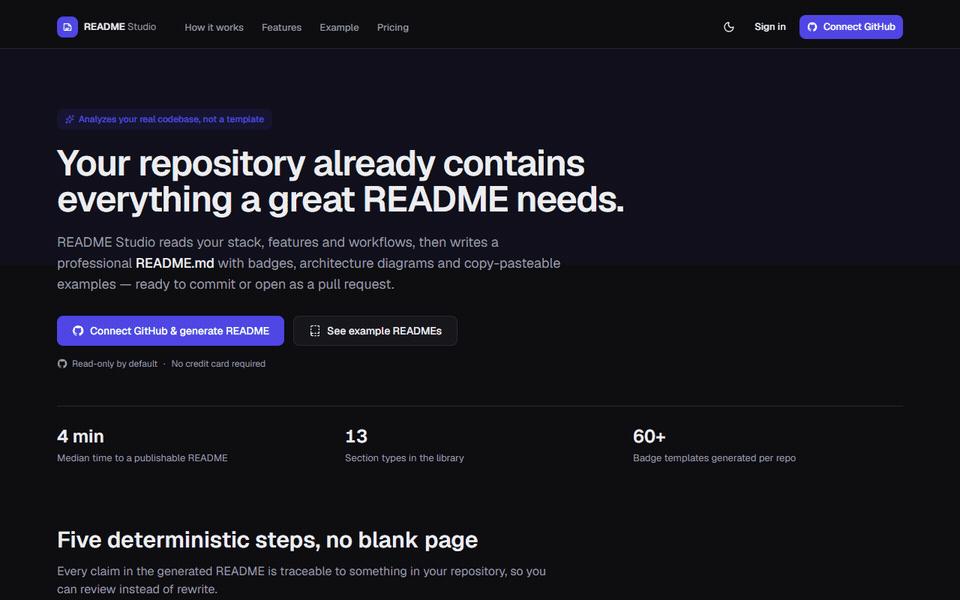
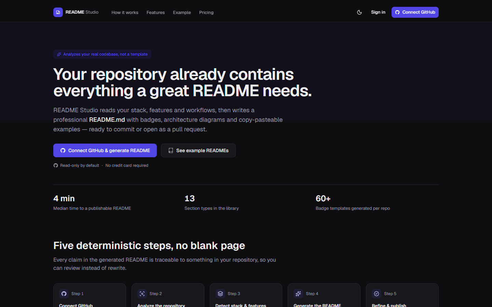
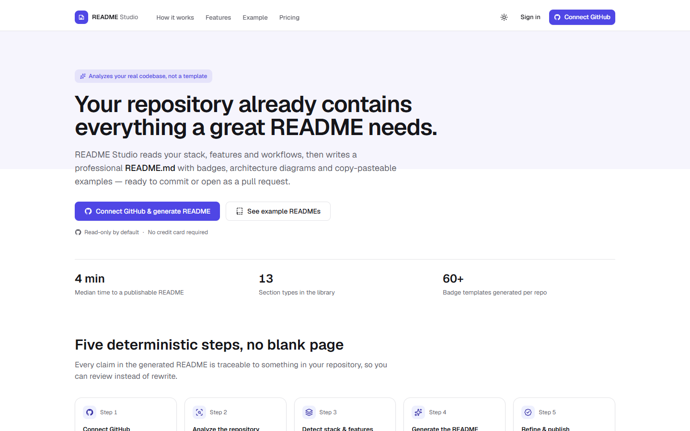
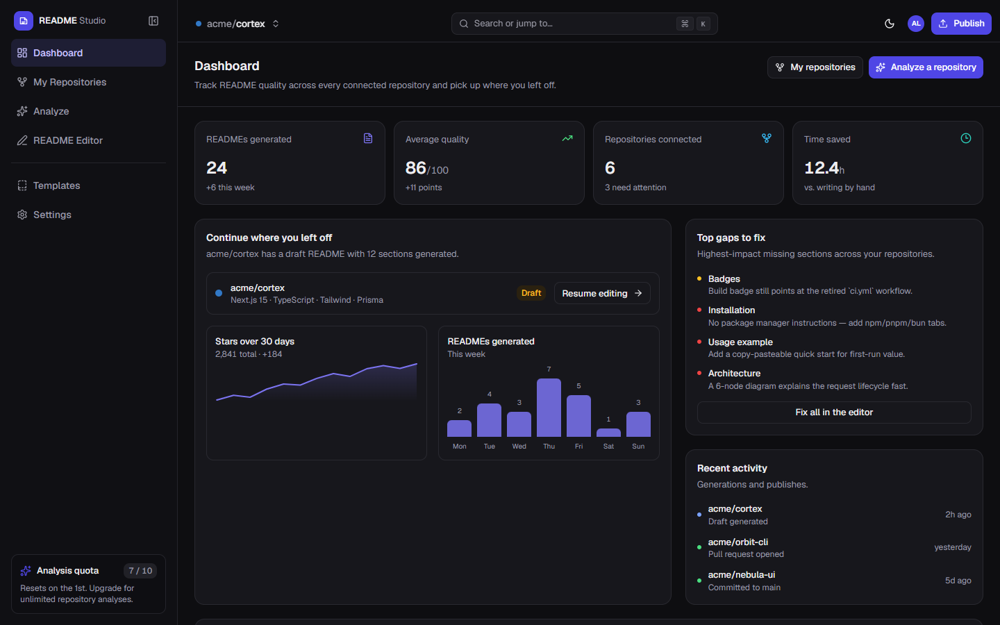
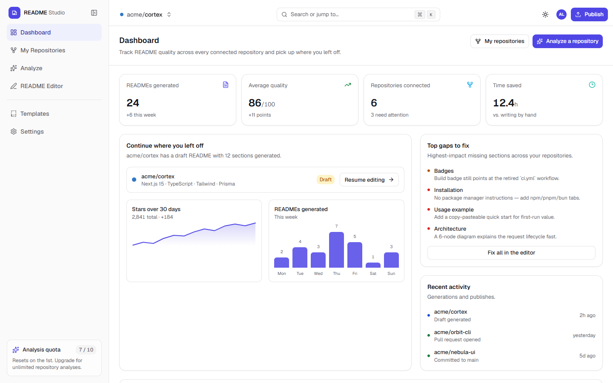
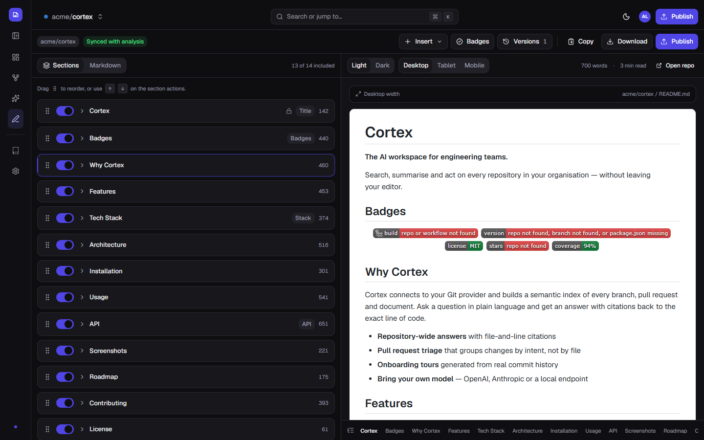
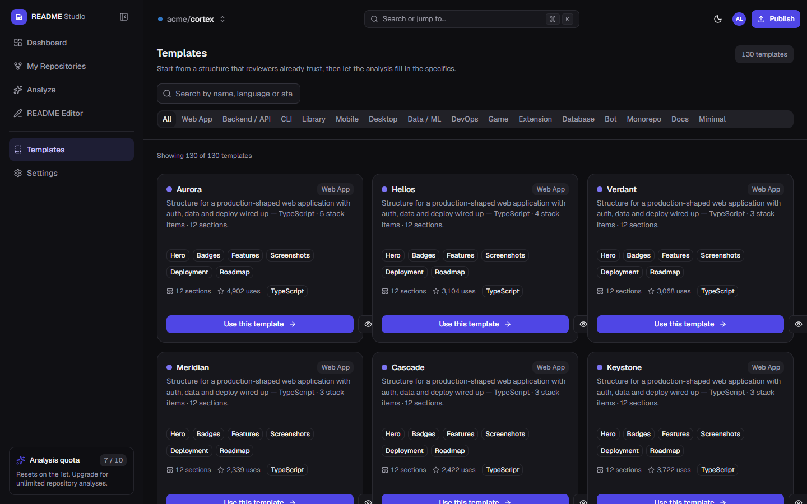
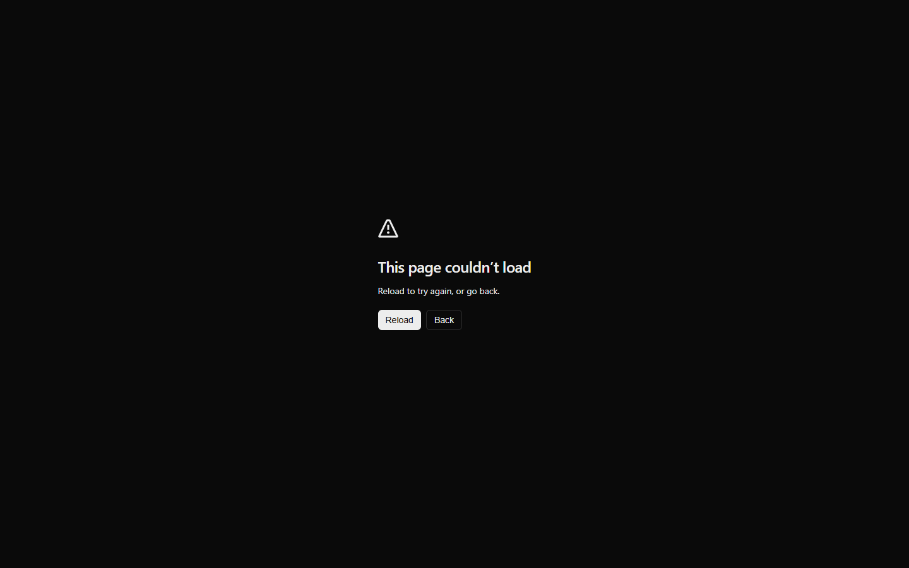
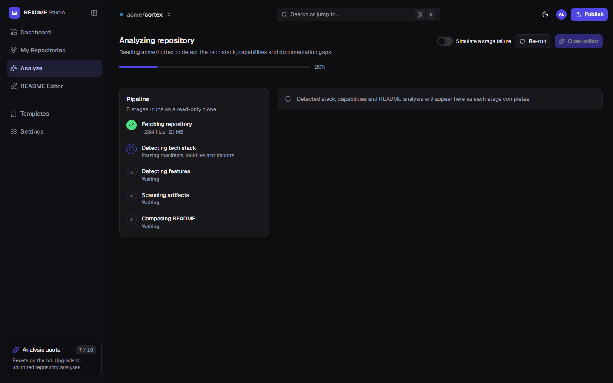
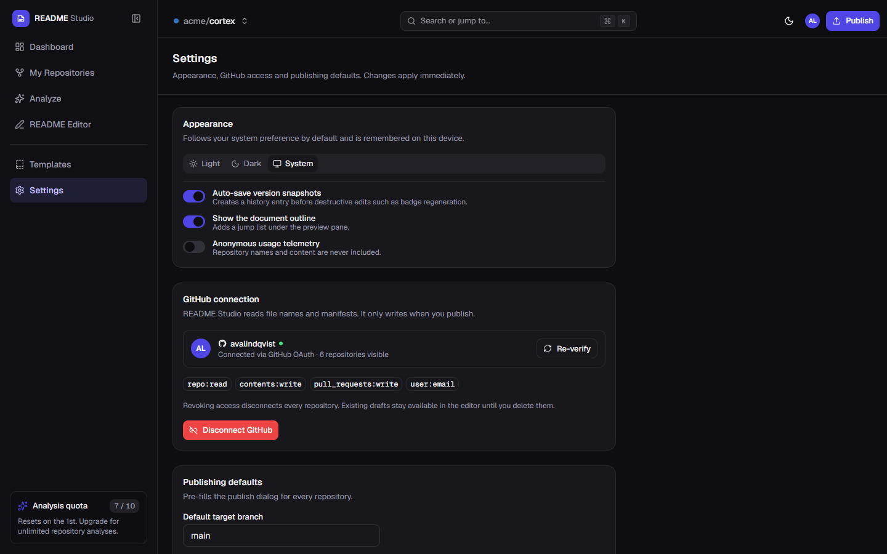

<div align="center" dir="rtl">

# 

**هر مخزنی را به‌ READMEی تبدیل کن که بخواند.**

کد پایه واقعی را تحلیل کن، از **۱۳۰ تامپلیت منتخب** برگزینش کن، در ویرایشگر دو‌پنلی با پیش‌نما زنده‌ی GitHub-flavoredRefine کنید، و منتشر کن — به عنوان یک کامیت یا یک pull request.

[](https://nextjs.org)
[](https://react.dev)
[](https://www.typescriptlang.org)
[](https://tailwindcss.com)
[](LICENSE)
[](https://github.com/mohammadhossein-asadi/github-readme-studio/pulls)

[**مثال را کاوش کن**](#-screenshots) · [**ویژگی‌ها**](#-features) · [**شروع سریع**](#-quick-start) · [**تامپلیت‌ها**](#-130-readme-templates)

<br/>



<p><sub>Queue کردن مخازن → تحلیل پنج مرحله‌ای → ویرایش بخش‌ها و منبع markdown → پیش‌نما زنده → انتشار به صورت pull request.</sub></p>

</div>

---

## ✨ این چیست؟

GitHub README Studio یک SaaS Next.js شکل‌داده‌شده برای تولید است که مستندات را ب、同じ شیوه‌ای می‌نویسد که یک مهندس ارشد می‌نویسد: **هر ادعا به چیزی در مخزن شما ریشه دارد**. یک لوله‌کشی پنج مرحله‌ای manifest‌ها، راوترها، تست‌ها و ورکفلوها شما را می‌خواند، سپس یک پیش‌نما ساختاریافته به شما می‌دهد که بصری Refine می‌کنید — بدون صفحه خالی، بدون کپی-پیست boilerplate، بدون بدجی‌ها که کهنه شده باشند.

<table>
<tr>
<td width="50%">

### 🧠 تحلیل قطعی
پنج مرحله — فراتک، کشف پشته، کشف ویژگی‌ها، اسکن‌آرتیفکت‌ها، کامپوز — روی یک کلون فقط‌خوان با پیش‌روی هر مرحله و شبیه‌سازی شکست اجرا می‌شوند.

### ✍️ ویرایشگر که نمی‌دهد؟
بخش‌ها را Toggle، مرتب‌سازی دraggable و ویرایش کن؛ پیش‌نما GitHub-flavored را زنده در عرض دسکتاپ، تبلت و موبایل ببین؛ از طریق इतिहาส نسخه revert کن.

</td>
<td width="50%">

### 📊 بدجی‌ها، نمودارها و پشته فناوری
شیء کلیک برای بدجی‌های build،نسخه، مجوز، پوشش و ستاره‌ها — به‌همراه نمودارهای تاریخ ستاره و جدول پشته فناوری کشف‌شده.

### 🚀 منتشر کردن ایمن
کپی، دانلود `.md`، کامیت به شاخه، یا باز کردن یک pull request — هر عمل تخریبی پشت یک دیالوگ تأیید صریح محافظت‌شده.

</td>
</tr>
</table>

## 📸 اسکرین‌شات‌ها

<details open>
<summary><b>لندینگ و داشبورد</b></summary>

<br/>

<table>
<tr>
<td align="center"><b>تاریک</b></td>
<td align="center"><b>روشن</b></td>
</tr>
<tr>
<td></td>
<td></td>
</tr>
<tr>
<td align="center"><b>داشبورد — تاریک</b></td>
<td align="center"><b>داشبورد — روشن</b></td>
</tr>
<tr>
<td></td>
<td></td>
</tr>
</table>

</details>

<details open>
<summary><b>ویرایشگر و تامپلیت‌ها</b></summary>

<br/>

<table>
<tr>
<td align="center"><b>ویرایشگر README — بخش‌ها، ابزارها و پیش‌نما زنده</b></td>
</tr>
<tr>
<td></td>
</tr>
<tr>
<td align="center"><b>گالری تامپلیت — ۱۳۰ تامپلیت، جستجو بر اساس نوع و زبان</b></td>
</tr>
<tr>
<td></td>
</tr>
</table>

</details>

<details open>
<summary><b>مخازن، تحلیل و تنظیمات</b></summary>

<br/>

<table>
<tr>
<td align="center"><b>مرورگر مخازن</b></td>
<td align="center"><b>لوله‌کشی تحلیل</b></td>
</tr>
<tr>
<td></td>
<td></td>
</tr>
<tr>
<td align="center"><b colspan="2">تنظیمات — ظاهر، دسترسی GitHub و پیش‌فرض‌های انتشار</b></td>
</tr>
<tr>
<td colspan="2"></td>
</tr>
</table>

</details>

## 🧩 ویژگی‌ها

- **اتصال GitHub و انتخاب مخزن** — جستجو، فیلتر بر اساس دیدایی، مرتب‌سازی بر اساس ستاره یا جدید بودن، و بررسی امتیاز کیفیت README پیش از شروع.
- **لوله‌کشی تحلیل پیش‌رونده** — پنج مرحله استریم‌شده با پیش‌روی زنده، پشتیبانی از دوباره اجرا، و Toggle برای شبیه‌سازی شکست مراحل.
- **ویرایشگر دو‌پنلی README** — Toggle بخش‌ها با مرتب‌سازی Drag-to-reorder، حالت منبع markdown با های‌لایت سینتکس، و پیش‌نمای زنده GFM (جداول، لیست‌های کار، پانوشت، HTML خام) با پیش‌فرض‌هایviewport رسپانسیو.
- **استودیو بدجی‌ها** — بدجی‌های shields.io برای build، نسخه، مجوز، ستاره و پوشش، تولید‌شده از پشته کشف‌شده.
- **کتابخانه دریافت** — ویژگی‌ها، جدول پشته فناوری، دیاگرام‌های معماری، مرجع API، اسکرین‌شات‌ها و نقشه راه در یک کلیک.
- **دستیار‌های Rewrite هوش مصنوعی** — عملیات پolish، کوتاه‌سازی، تنگ‌کنندگی و گسترش روی هر بخش.
- **تشخیص نسخه** — اسنپ‌شات‌های خودکار با بازگشت فرUnless به diff.
- **جریان انتشار** — کپی، دانلود `.md`، کامیت به شاخه یا باز کردن PR، هر کدام پشت یک دیالوگ تأیید صریح با هشدارهای اجازه.
- **پالت دستور** — `⌘K` ناوبری در میان مخازن، بخش‌ها و اقدامات.
- **۱۳۰ تامپلیت README** در ۱۵ نوع پروژه، هر یک با مستند کامل (هیرو，بدجی‌ها，ویژگی‌ها，نصب，استفاده، extras خاص نوع).
- **تم‌های تاریک و روشن** — آگاه به سیستم، به‌یاد曼每設備، بررسی کنتراست به WCAG AA.
- **رسپانسیو و قابل‌دسترسی** — ناوبری د raور موبایل، حاشیه‌های safe-area، حلقه‌های فاکوس، لینک‌های شکیبای، حالت‌های لود اسکلت، و ناحیه‌های وضعیت `aria-live`.

## 📁 فهرست اسکرین‌شات‌ها

| بخش | راوتر | اسکرین‌شات |
| --- | --- | --- |
| صفحه لندینگ | `/` | `docs/screenshots/landing-{dark,light}.png` |
| داشبورد | `/dashboard` | `docs/screenshots/dashboard-{dark,light}.png` |
| مخازن | `/repos` | `docs/screenshots/repos-dark.png` |
| تحلیل | `/analyze` | `docs/screenshots/analyze-dark.png` |
| ویرایشگر | `/editor` | `docs/screenshots/editor-{dark,light}.png` |
| تامپلیت‌ها | `/templates` | `docs/screenshots/templates-{dark,light}.png` |
| تنظیمات | `/settings` | `docs/screenshots/settings-dark.png` |

## 🧱 پشته فناوری

| لایه | گزینه‌ها |
| --- | --- |
| فریم‌ورک | Next.js 16 (App Router, Turbopack)، React 19 |
| استایل | Tailwind CSS v4، `tw-animate-css`، توکن‌های طراحی CSS-first |
| کامپوننت‌ها | اصول اولیه Radix UI، cmdk، sonner، react-resizable-panels v4 |
| markdown | react-markdown + remark-gfm + rehype-raw، CodeMirror 6 |
| حرکت و آیکون‌ها | motion، lucide-react |
| کیفیت | TypeScript 5، ESLint 9 (`eslint-config-next`) |

## 🚀 شروع سریع

```bash
git clone https://github.com/mohammadhossein-asadi/github-readme-studio.git
cd github-readme-studio
npm install
npm run dev
```

برو به [http://localhost:3000](http://localhost:3000) — صفحه لندینگ استقبال می‌کند، سپس به **تامپلیت‌ها** یا **اتصال GitHub** برو تا به ویرایشگر رسید.

```bash
npm run build   # بیلد تولید (۱۲ راوتر، کاملاً استاتیک هرجا ممکن بود)
npm start       # ارائه بیلد تولید
npm run lint    # ESLint
```

## 📁 ساختار پروژه

```
src/
├── app/
│   ├── page.tsx              # صفحه لندینگ
│   └── (app)/                # پو영 اصلی احراز شده
│       ├── dashboard/        # متریک‌ها، نمودارها، شکستگی‌ها، فعالیت
│       ├── repos/            # مرورگر مخازن و Queue کردن
│       ├── analyze/          # UI لوله‌کشی پنج مرحله‌ای
│       ├── editor/           # ویرایشگر دو‌پنلی README
│       ├── templates/        # گالری ۱۳۰ تامپلیت
│       └── settings/         # ظاهر, GitHub, انتشار
├── components/
│   ├── app-shell/            # سایدبار, بالار, پالت دستور, ارائه‌دهندگان
│   ├── editor/               # بخش‌ها, پیش‌نما، بدجی‌ها، نسخه‌ها، انتشار
│   ├── landing/              # بخش‌های مارکتینگ
│   └── ui/                   # اصول اولیه قابل‌دسترسی (Radix + CVA)
└── lib/
    ├── mock/                 # مخازن، نتایج تحلیل, ۱۳۰ بذر تامپلیت
    └── *.ts                  # ابزارها، تایپ‌ها, حالت فضای کار
```

## ✅ تأیید شده

```bash
npx tsc --noEmit   # تمیز
npx eslint .       # تمیز
npm run build      # ۱۲/۱۲ راوتر
```

## 📄 مجوز

MIT — به [LICENSE](LICENSE) مراجعه کن.
